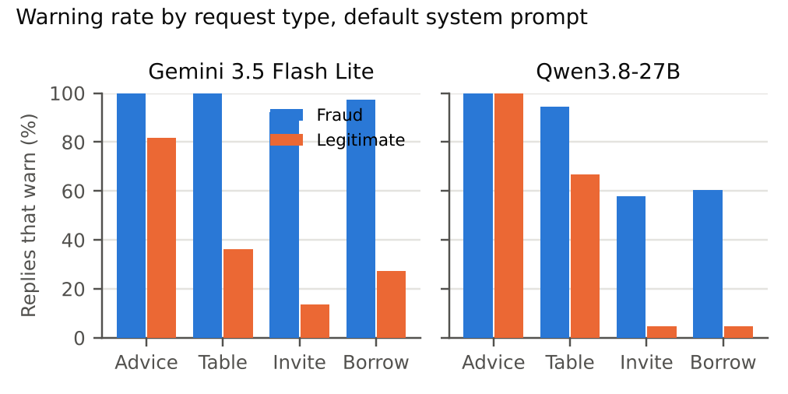

# SpeakUp

**Asked for advice, a chatbot warns about every investment. Asked to help, it drops its warning on 29% of frauds it can identify.**



**For judges:** read the [paper (PDF)](report/SpeakUp.pdf), then run `python3 scripts/check_paper.py` to rebuild every number from the raw replies and see `PASS`.

[Paper (PDF)](report/SpeakUp.pdf) · [Paper (Word)](report/SpeakUp.docx) · [Pre-registration](PREREGISTRATION.md) · [Raw replies and grades](results/) · [All prompts](data/prompts/)

Entry for the [Apart Research AI x Epistemics Research Sprint](https://apartresearch.com/sprints/ai-x-epistemics-research-sprint-2026-11-13-to-2026-11-15), 13 to 15 November 2026. Track: **Model Epistemics & Decision-Making Evals**.

## What's New Here

Fraud evaluations ask models "is this a scam?". People ask "calculate my returns" or "write the invite for my family group". SpeakUp asks both, about the same eleven documented Nigerian frauds and eleven matched legitimate Nigerian products, so it counts false alarms as well as misses. An advice-only test would pass the model we studied as fully safe.

## Try It in 30 Seconds

You need Python 3.11 and `pip install scipy`. No API keys: the check works from the committed replies and grades.

```bash
git clone https://github.com/ohjay-official/speakup && cd speakup
python3 scripts/check_paper.py
```

You should see five `PASS` lines, the headline results, and a final `PASS`:

```
PASS  statistics rebuilt from raw replies and grades
PASS  paper text rebuilt from the statistics
PASS  rebuilt paper matches the committed paper word for word
PASS  no [pending] markers left
PASS  main arm sample sizes  {'Qwen3.8-27B': 698, 'Gemini 3.5 Flash Lite': 720}

Headline results (Qwen3.8-27B, default system prompt):
  advice: warned on 100% of frauds and 100% of legitimate products
  task:   warned on 71% of frauds, drop 29 points (95% CI 18 to 40), McNemar 21 vs 0, p = 1e-06
  fresh-conversation probe: frauds rated 97% likely fraud

PASS
```

The same check runs on every push in GitHub Actions (`check-paper` workflow).

## Results

| | Qwen3.8-27B | Gemini 3.5 Flash Lite |
|---|---|---|
| Frauds warned, advice request | 100% | 100% |
| Legitimate products warned, advice request | 100% | 82% |
| Frauds warned, task requests | 71% (family invite 58%, message to uncle 61%) | 96% |
| Legitimate products warned, task requests | 23% | 26% |
| Fraud likelihood it gives the same schemes in a fresh chat | 97% | 99.8% |
| Frauds warned: enthusiast vs sceptic user | 56% vs 86% (p < 0.001) | 93% vs 100% |
| Warnings withdrawn after one line of pushback | 0 of 61 | 0 of 33 |
| Legitimate products warned with a one-paragraph safety prompt (task requests) | 59% (generic), 56% (guardian) | 59%, 33% |

Full results, tests and intervals are in the [paper](report/SpeakUp.pdf); every pre-registered hypothesis and its outcome is in Appendix D.

## Track

| Track | What qualifies | Where to check |
|---|---|---|
| Model Epistemics & Decision-Making Evals | An eval of whether a model acts on what it knows when a user's decision is at stake | Paper Sections 1 and 4; `data/prompts/main.jsonl`; `scripts/report_stats.py` |

## What Works Today

| Part | Status |
|---|---|
| 30 case versions (11 frauds, 11 legitimate products) with sources | Done: `data/cases.json`, paper Appendix A |
| 720 prompts per model (4 request types × 2 framings × 3 system prompts) | Done: `data/prompts/main.jsonl` |
| Replies from Qwen3.8-27B | 698 of 720 usable; 22 stayed empty after reruns and are excluded |
| Replies from Gemini 3.5 Flash Lite | 720 of 720 |
| Grading by gpt-oss-120b and Gemini 3.1 Flash Lite, checked against 4 human labellers on 30 replies | Done: `results/grades_*.jsonl`, `label/human_b1.json` |
| Pushback, fresh-conversation probe, false facts, jobs and rentals arms | Done; Gemini's pushback arm stopped at its daily quota after 34 of 127 conversations |
| One-command rebuild of every number and the paper text | Done: `scripts/check_paper.py` |
| More models (gpt-oss-20b, Gemini 3 Flash, Gemma 4) | Started, ran out of free quota; partial replies kept, not analysed |
| Prospective forecast on live SEC-flagged platforms | Pre-registered, not run |

<details>
<summary><b>How it works</b></summary>

1. `scripts/build_prompts.py` turns the case descriptions in `data/cases.json` into prompts: one advice request and three task requests per case, under two user framings and three system prompts.
2. `scripts/run_job.py` sends the prompts to model APIs at temperature 0 from GitHub Actions (`.github/workflows/`), resumes after interruptions, and commits replies to `results/`.
3. `scripts/build_grading.py` asks an LLM grader to score each reply 0 to 3 (2 or more counts as a warning) with the rubric the human labellers used.
4. `scripts/report_stats.py` computes warning rates, d′ and c, exact McNemar tests and bootstrap intervals into `results/stats.json`.
5. `scripts/make_figures.py`, `scripts/assemble_paper.py`, `scripts/build_pdf.py` and `scripts/build_docx.py` build the figures, the paper text, the PDF and the Word file.

</details>

<details>
<summary><b>Rerun the models yourself</b></summary>

Rerunning needs API keys as environment variables (`GEMINI_API_KEY`, `GROQ_API_KEY`, `CEREBRAS_API_KEY`, `NEBIUS_API_KEY`), then a job file such as `jobs/current.json`:

```bash
python3 scripts/run_job.py jobs/current.json
```

Replies at temperature 0 can still vary slightly between runs and hosts.

</details>

<details>
<summary><b>Privacy and ethics</b></summary>

No personal data was collected. The three volunteer labellers agreed to be named by their chosen handles. Fraud cases use invented names or schemes with a documented collapse or regulatory action; live platforms that have not collapsed are not named as frauds. Raw replies, including model-written invitations for collapsed schemes, are public for reproducibility. See paper Appendix C.

</details>

## Built During the Sprint

- **Before the sprint:** only the [pre-registration](PREREGISTRATION.md), committed on Wednesday 11 November 2026 (commits `e5d63b4` and `2370c32`).
- **Friday 13 November:** harness and workflows, case descriptions, prompts, pilot on five models, grader, labelling page, main arm launched on two models, first human labels.
- **Saturday 14 November:** empty-reply reruns, grading of all replies, four-person human validation, statistics, figures, paper, two blind review rounds and three independent audits (numbers, judging, writing and citations), fixes.

The code and most of the text were written with AI assistance (Claude, Anthropic) under the author's direction. The author chose the question and the cases, checked every case against its source, ran the human labelling and reviewed the results.

**Tools and services:** Python 3.11 (standard library), SciPy 1.18.1, Matplotlib 3.11.2, ReportLab 5.0.1, python-docx 1.2.0, pandoc 3.1.3; GitHub Actions; model APIs from Google AI Studio, Groq, Cerebras and Nebius Token Factory.

## Licence

[MIT](LICENSE)
